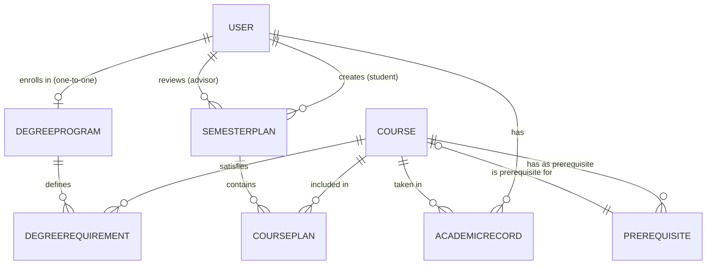

# COMP 3613 Assignment 1

Draft this file with the Guide. **Update it after every phase milestone** before you pause. The use-case diagram is a UML PNG at `docs/diagrams/use-case.png`, linked from this file as `diagrams/use-case.png` (path relative to `docs/report.md`). The model diagram is Mermaid. **Embed wireframe images** as `wireframes/<file>` (files live in `docs/wireframes/`).

Do not put your student ID in this file if you will commit it. The PDF cover adds your name and ID at export time.

## Assigned project

MyAdvisor

## Three workflows

### 1. Plan Semester Courses (Student)

### 2. Track Degree Progress (Student)

### 3. Approve Semester Plan (Advisor)

## Use case diagram

**Assumed relationships:**
- "View Degree Progress" is **included** in "Plan Semester Courses" so students see requirements while planning.
- "Track Degree Progress" is a separate use case students can access independently.
- The "View Degree Progress" action in the planning flow links directly to the dedicated tracking page; this does not change the use-case structure, only the navigation path.
- "Approve Semester Plan" allows the advisor to approve or flag the plan with required changes.

## Model diagram

First draft. Update this section in Phase 5 when polish revises the model, and note what changed.

**Relationship notes:**
- **User ↔ DegreeProgram:** One student to one degree program (one-to-one).
- **Course (self-referential) via Prerequisite:** Many-to-many; the Prerequisite join table links a course to its prerequisites.
- **User (advisor) ↔ SemesterPlan:** One advisor per plan (one-to-one FK on SemesterPlan).
- **SemesterPlan status:** `pending`, `flagged_for_changes`, `approved`; includes `advisor_id` and `review_date`.

**Assumed properties added to SemesterPlan:** `advisor_id`, `review_date`.
**Assumed:** User needs a `degree_program_id` field to track which program a student is enrolled in.

## Wireframes

### Plan Semester Courses (Student)

### Track Degree Progress (Student)

### Approve Semester Plan (Advisor)

<!-- student-build:wireframe-coverage
use_case: Plan Semester Courses
image: docs/wireframes/myAdvisor.png
covered: yes
-->

<!-- student-build:wireframe-coverage
use_case: Track Degree Progress
image: docs/wireframes/myAdvisor.png
covered: yes
-->

<!-- student-build:wireframe-coverage
use_case: Approve Semester Plan
image: docs/wireframes/myAdvisor.png
covered: yes
-->

**Phase 4 review:**
- The uploaded wireframe covers all three named workflows in one combined view.
- No major change is needed to the use-case diagram: the student can plan courses while viewing degree progress, and the advisor can approve a plan or flag it for changes.
- The planning screen’s “View Degree Progress” link opens the tracking page directly; this is a navigation link, not a separate use-case change.
- Model metadata visible in the design: `SemesterPlan.status`, `SemesterPlan.advising_session_notes`, `SemesterPlan.advisor_id`, `SemesterPlan.review_date`, `CoursePlan.course_id`, `AcademicRecord.grade`, `AcademicRecord.status`.
- One minor design note: if the advisor flags a plan for changes, the UI should clearly show the required change notes and keep the plan in a non-approved state until resubmitted.

## Theming

- Colors: Violet, white, and cream, with green for approved plans, amber for pending plans, and red for changes requested.
- Type: Professional font face with bold headings and simple body text.
- Tone: Professional and calm.
- Logo / wordmark: MyAdvisor with a simple academic icon integrated into the violet and cream palette.

## Implementation notes

### Phase 5 milestone updates
- Landing page content is centered and the `MyAdvisor` title is visually emphasized in the public header and app top bar.
- Student dashboard now displays advisor feedback when a plan is approved or flagged for changes, so the notes are visible after review.
- Role-sensitive sidebar and advisor queue updates remain in place for the student/advisor workflow.
- Verification step: confirm the student can submit a plan, an advisor can approve/request changes, and the student sees the latest notes on their dashboard.

One named workflow at a time. Include verify notes and polish / model revisions (Phase 5). Do not treat the first build as final.

## Deployed app

Phase 6. Public Render URL (not localhost). Markers open this to mark the three workflows.

https://

## Logins

Every account a marker needs, including extra users you added. Starter accounts:

- bob / bobpass — regular user
- admin / adminpass — admin

## YouTube URL

## Session transcripts

Filled when the Guide builds the report: the agent writes each Guide chat to `docs/transcripts/<slug>.md` (Copilot Agent, Cursor, or OpenCode). `python manage.py report` packages them. Do not paste chats here during the build.

## Competency (student-judge)

Filled when the report is built. Guide runs student-judge, writes `docs/judge.md`, and export appends the scorecard here.

## Skill integrity

Filled by `python manage.py report`. Do not edit the course skills.
