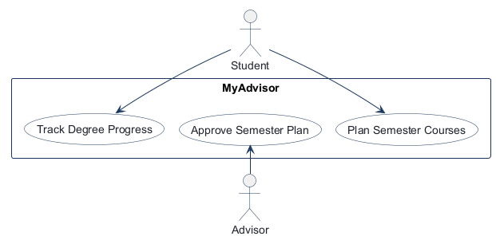
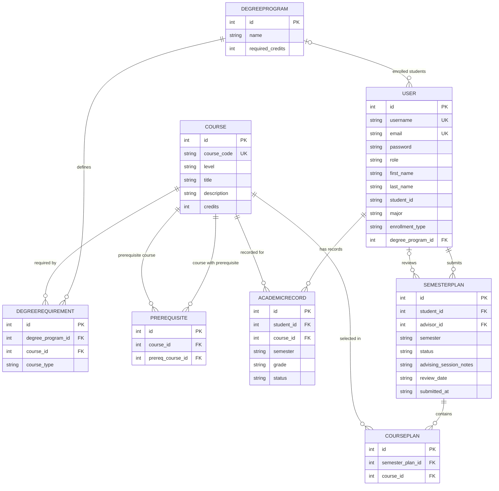
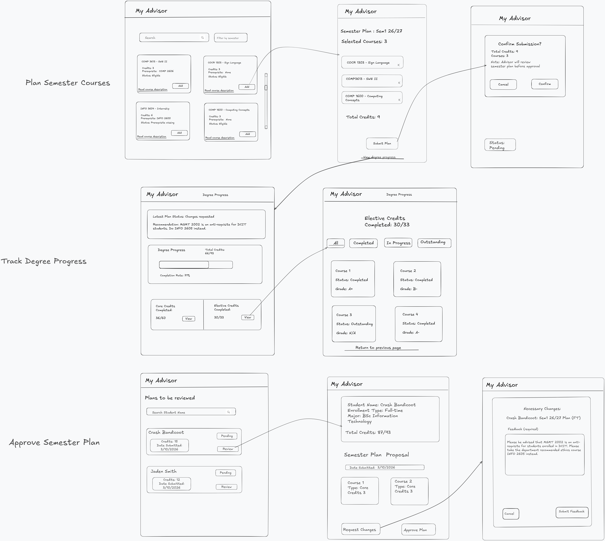

<!-- student-build:skill-integrity
status: pass
root: e84cd692d0b85eefe546385661958c27d07e8be6c5176a82012f68ccff5c8beb
expected_root: e84cd692d0b85eefe546385661958c27d07e8be6c5176a82012f68ccff5c8beb
mismatches: none
-->

# COMP 3613 Assignment 1

Draft this file with the Guide. **Update it after every phase milestone** before you pause. The use-case diagram is a UML PNG at `docs/diagrams/use-case.png`, linked from this file as `diagrams/use-case.png` (path relative to `docs/report.md`). The model diagram is Mermaid. **Embed wireframe images** as `wireframes/<file>` (files live in `docs/wireframes/`).

Do not put your student ID in this file if you will commit it. The PDF cover adds your name and ID at export time.

## Assigned project

MyAdvisor

## Agent 

Copilot Agent was used with BuildSkill

## Three workflows

### 1. Plan Semester Courses (Student)

The student starts by signing in and then opens Plan Semester (Plan Semester Courses) which is located on the sidebar. They can search the course catalog which holds many cards each showing information about the course such as the title, credits, course code, etc. They can add these courses to the My plan section on the right hand side of the screen and submit their plan to be reviewed by the advisor. This workflow is done once the plan section is filled out and sent off to the advisor.
 

### 2. Approve Semester Plan (Advisor)

The Advisor logs in as well and can approve the submitted semester plans from students. Advisors are able to see the queued requests for advising on screen which is cleared once a decision has been made. They are able to approve the plan or request changes to that semester plan and once they select an option a box pops up prompting for feedback which can be sent to the student user. This process is done once the feedback notes are sent back along with the recommendation selected via the appropriate button.

### 3. Track Degree Progress (Student)

Students can track their degree progress such as the status of their courses, course plan and overall degree progress. The feedback from the advisor is visible here so that students can make any required changes. Students are also able to mark courses complete and assign a grade to themselves for the purpose of keeping track of their academic performance across the semester. Once the selected courses change status from in-progress to complete the process is done or has been completed.

## Use case diagram

**Assumed relationships:**
- "Plan Semester Courses" and "Track Degree Progress" are separate student workflows, with navigation between them in the dashboard.
- "Approve Semester Plan" includes either approval with student feedback or a request for changes with feedback; course catalog and degree requirements are maintained outside this application.

## Model diagram

Implementation-aligned model. Properties and cardinalities below reflect the current SQLModel tables; optional foreign keys are shown as optional relationships.

**Relationship notes:**
- A student has one current degree-program foreign key; one program can be associated with many students. The foreign key is nullable and is not unique in the current schema.
- `Prerequisite` is a self-referential join entity between courses. `DegreeRequirement` joins programs and courses; `CoursePlan` joins semester plans and courses.
- A plan belongs to one student and may reference one reviewing advisor through nullable `advisor_id`; each user can be associated with many plans in either role.
- Stored semester-plan statuses are `pending`, `flagged_for_changes`, and `approved`. The interface displays `flagged_for_changes` as “Changes requested.” Plans also store advisor notes, reviewer ID, review date, and submission date.
- The UI derives `Outstanding` when a student has no academic record for a course. Persisted academic-record statuses used by the app are `in_progress` and `completed`; completed records can store a grade.

## Wireframes

### Plan Semester Courses (Student)

### Track Degree Progress (Student)

### Approve Semester Plan (Advisor)

<!-- student-build:wireframe-coverage
use_case: Plan Semester Courses
image: docs/wireframes/myadvisor.png
covered: yes
-->

<!-- student-build:wireframe-coverage
use_case: Track Degree Progress
image: docs/wireframes/myadvisor.png
covered: yes
-->

<!-- student-build:wireframe-coverage
use_case: Approve Semester Plan
image: docs/wireframes/myadvisor.png
covered: yes
-->

**Phase 4 review:**
- The uploaded wireframe covers all three named workflows in one combined view.
- Student navigation separates course planning from degree tracking while keeping both available from the dashboard.
- Model metadata represented by the wireframe includes plan status and advisor feedback, plan reviewer and review date, selected plan courses, academic-record status, and grades.

## Wireframe differences

- The wireframe shows the workflows together; the implemented student experience separates Plan Semester Courses and Track Degree Progress into distinct dashboard views.
- The plan page adds a searchable course catalog with an initial list, selected-plan summary, locally saved/resettable draft, and a confirmation step before actual submission.
- The advisor queue presents student identity and plan details in a selectable review layout. Approval and request-changes each collect feedback in a popup; approval notes are also shown to the student.
- Degree Progress adds status filters and a completion flow with optional A/B/C grade entry. Marking a course complete updates its academic record, completed-course count, status badge, and credit total; the student remains on the progress view after saving.
- The My plan summary shows each selected course as Planned, In progress, or Completed. The degree total is displayed against the 93-credit requirement.

## Theming

- Colors: Violet, white, and cream, with green for approved plans, amber for pending plans, and red for changes requested.
- Type: Professional font face with bold headings and simple body text.
- Tone: Professional and calm.
- Logo / wordmark: MyAdvisor with a simple academic icon integrated into the violet and cream palette.

## Implementation notes

### Phase 5 milestone updates
- Built on the COMP 3613 Assignment 1 FastStarter starter (FastAPI, SQLModel, SQLite locally, Jinja templates); student/advisor authentication and role navigation reuse the starter.
- The theme uses violet, white, and cream, with calm professional typography and MyAdvisor branding. The public landing layout and top-bar wordmark were refined during polish.
- Students can select and submit a semester plan, save/reset a temporary local draft, view advisor feedback, track degree records, and mark in-progress courses complete with an optional grade.
- Advisors review a pending-plan queue, approve with feedback, or request changes with feedback. The stored plan status and feedback return to the student dashboard.
- Course completion updates the AcademicRecord, status categories, completed-course count, and credits complete; the completion form returns the student to Track Degree Progress.
- Phase 5 polish was student-steered through repeated local tests and mismatch reports, including catalog visibility/search, draft persistence, modal submissions, completed-course placement/counts, and status visibility in My plan.

## Deployed app

Phase 6. Deployed on Render with a free Oregon web service and free Oregon PostgreSQL 16 instance. The public root loads and `GET /health` returned `{"ok":true}` during this report update. This health endpoint is an HTTP liveness check and does not query Postgres. Direct SQL verification through the hosted Render MCP was blocked because the database external IP allowlist denies that connection; the database credentials are not included here. Render’s free database expires after 30 days.

https://faststarter-qyul.onrender.com

Render service: `faststarter` (Python, free, Oregon), deployed from `main` at commit `093d496`.
Render database: `faststarter-db` (PostgreSQL 16, free, Oregon). Database credentials are intentionally not included here.

## GitHub

https://github.com/christiam44/comp3613-myadvisor

## Logins

Every account a marker needs, including extra users you added. Starter accounts:

- bob / bobpass — regular user
- admin / adminpass — admin
- student1 / studentpass - regular user
- advisor / advisorpass - advisor

## YouTube URL

https://youtu.be/3jIh2ISJuuk

## Session transcripts

Filled when the Guide builds the report: the agent writes chat markdown into `docs/transcripts/`; `python manage.py report` packages them.

Guide packaged **1** chat(s) in `docs/transcripts/` (and `docs/transcripts.zip`).

Index: [docs/transcripts/INDEX.md](transcripts/INDEX.md)

- [`myadvisor-guide`](transcripts/myadvisor-guide.md)

## Competency (student-judge)

Filled by Guide from the student-judge run when this report was built.

**Judged at:** 2026-10-11T23:48:21-04:00
**Student / session:** MyAdvisor student / Copilot Agent all-phase conversation
**Artifact:** Native Copilot transcript at `docs/transcripts/myadvisor-guide.md`, current `docs/report.md`, `docs/diagrams/`, `docs/wireframes/`, and current app routes/models
**Phases in evidence:** 1–6 (COMP 3613; Phase 5 polish, Phase 6 deploy; never generic 0–5)
**Evidence pass:** Re-read the native all-phase chat and current artifacts; prior scorecards ignored.

### Totals
| | Count / value |
|--|--|
| Metrics on rubric | 12 (M1–M12) |
| N/A (excluded) | 0 |
| Metrics scored | 12 |
| Scoreable max | 48 |
| Awarded total | 45 / 48 |
| **Overall (avg of scored)** | **3.75 / 4** |
| Impression mark | 19 / 20 (rounded from overall; no separate Guide confidence value was logged) |

## Scorecard

| ID | Metric | Score / 4 | In avg | Evidence |
|----|--------|----------:|:------:|----------|
| M1 | Phase discipline | 3 | yes | The student explicitly moved through Phases 1–6. Phase 5 included substantial local testing and polish before deployment. The final advisor-approval-note modal was added near the Phase 6 transition and has no explicit student verification note. |
| M2 | Problem framing | 4 | yes | Student named MyAdvisor and all three workflows, then owned model details: “One student pursues a single degree program at a time”; plan statuses, advisor notes, reviewer identity/date, and the prerequisite many-to-many choice were also specified. |
| M3 | Decision ownership | 4 | yes | Student repeatedly chose workflow behavior and refinements, including: “They should be separate flows but make it so that students can view their degree progress while planning for the semester,” plus detailed corrections to course search, plan status, course completion, and advisor feedback. |
| M4 | Artefact-before-code | 4 | yes | The report contains the student-named ERD and all three workflow wireframe references. The student asked to “ensure the models are implemented as spec in the erd” and later updated the wireframe navigation before the Phase 5 build. |
| M5 | Verification habit | 4 | yes | Student ran the local app and reported observed mismatches in detail, then repeated testing across the student and advisor workflows. They reported: “The feature works perfectly now” after completion status/count fixes, and continued to request refinements rather than accepting the first build. |
| M6 | Assignment fit | 3 | yes | Implementation uses the FastStarter stack, requested models, role-based flows, and thin routes delegating to MyAdvisor services/repositories. No router-side SQL was found. Final report now describes the implementation and wireframe deviations. |
| M7 | Slice explanation | 3 | yes | Student explained domain decisions and concrete mismatches in their own words, including course status/credit behavior and advisor review states. The Guide did not elicit the required SQLModel/thin-route snippet checks, so their absence is not a student gap. |
| M8 | Prompt quality | 4 | yes | Prompts were phase-specific and included actionable expected behavior and test observations, e.g. “Once the courses in the current semester plan are completed please update the my plan area … to say completed.” |
| M9 | Response to pushback | 4 | yes | Student kept steering iterative polish: catalog defaults/live search, draft persistence, completion behavior, status display, and advisor approval notes. They did not stop at the initial working screen. |
| M10 | Integrity | 4 | yes | No clear external-assist/paste-back signal, edited-skill evidence, or transcript manipulation appeared in the available conversation. Student decisions appear in their own concise wording. |
| M11 | Provenance continuity | 4 | yes | Work stays anchored to MyAdvisor, the student’s eight named entities, their wireframe, and the three original workflows; the updated transcript retains the same project history through deployment. |
| M12 | Sincerity trajectory | 4 | yes | No suspicion protocol was needed; no sincerity blocks, evasive spiral, or abandonment occurred. |

## Strengths
- Strong Phase 5 verification and polish: the student reported actual browser behavior and supplied concrete mismatch notes across many iterations.
- Clear ownership of workflows, data entities, relationships, theme, status semantics, and wireframe navigation.
- Phase 6 deployment is represented by a public Render web service and Postgres instance; the public root loaded and `/health` returned `{"ok":true}` during this assessment.

## Gaps (priority order)
1. The final approval-feedback modal was implemented immediately before the Phase 6 transition, but the available transcript does not show a student test result for that exact last change. Earlier approval/request-changes feedback flows were tested and refined.
2. Render’s MCP cannot query this Postgres instance externally because its IP allowlist blocks the hosted MCP. The database resource is available and the live app health endpoint responds, but this assessment could not independently inspect the database schema or prove data persistence with a direct SQL query. The `/health` handler itself is static and does not query Postgres.

## Phase gate status
| Phase | Status | Note |
|-------|--------|------|
| 1 | met | Student selected MyAdvisor and named the three required `Feature (user)` workflows. |
| 2 | met | Student clarified separate planning/progress flows, external catalog administration, and approve-or-request-changes behavior; use-case PNG regenerated from the current three workflows. |
| 3 | met | Student named eight entities/properties and clarified degree-program, prerequisite, and advisor-plan relationships; report ERD now reflects current SQLModel tables. |
| 4 | met | Student-crafted `docs/wireframes/myadvisor.png` is embedded under each workflow with working report-relative links. |
| 5 | met | Student verified locally and steered extensive theme, workflow, and UI polish. See the small final-modal verification caveat above. |
| 6 | met | Render free Oregon web service and PostgreSQL 16 are present; app root and health endpoint verified. Direct external DB inspection is blocked by the database allowlist. Public URL and marker logins are in `docs/report.md`. |

## Recommended next practice
- Trace “Mark complete” through Route → Service → Repository → AcademicRecord/ Course and annotate which layer validates the request, persists status/grade, and derives completed credits. This builds on the student’s detailed behavior ownership while strengthening explicit layer explanation.

## Integrity note
- Clean: no evidence of external-LLM laundering or edited course skills in the available native transcript and workspace artifacts.

## Provenance flags
- None. The local session store contains one Copilot Agent conversation spanning Phases 1–6; its complete rendered user/Guide messages are exported to `docs/transcripts/myadvisor-guide.md`.

## Sincerity log summary
- Blocks found: 0 | max round: 0 | min/mean/final confidence: N/A | trend: none | cleared: yes (suspicion not raised)

## Skips
- Skips: 0/3 used.

## Skill integrity

Course skills are hashed at export and compared to `.agents/skills.lock.json`. Do not edit `.agents/skills/`, `.cursor/skills/`, or `AGENTS.md`.

- Status: **pass**
- Root: `e84cd692d0b85eefe546385661958c27d07e8be6c5176a82012f68ccff5c8beb`
- none
